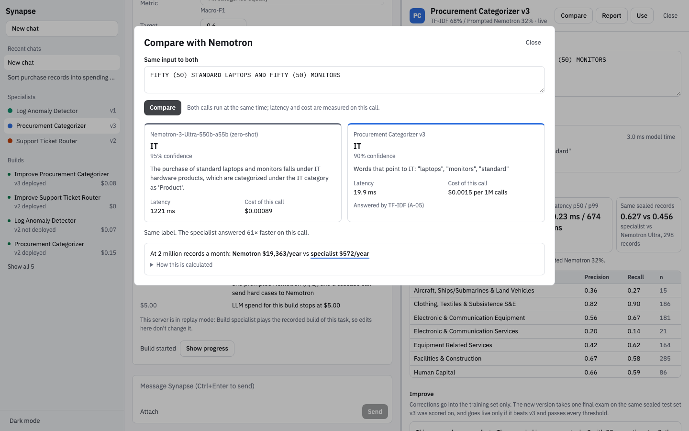

# Synapse

Describe a repetitive task in plain English. Synapse benchmarks rules, classic ML, embeddings and smaller LLMs
against NVIDIA Nemotron Ultra, then ships the cheapest specialist that passes your bar, with measured savings.



- **Live demo:** https://synapse-red-ten.vercel.app/ (API: the Nebius Serverless endpoint below)
- **Video (3 min):** _YouTube link goes here_
- Built for the Nebius x NVIDIA Global AI Hackathon, Coding and Agentic Engineering track. MIT licensed.

## The problem

Teams send every repetitive record (a purchase line, a log window, a support message) to a frontier model and pay
frontier prices for what is really one narrow classification. A small specialist could do most of that work for a
fraction of the cost, but building one means picking a method, getting data, testing honestly and keeping it
up to date. Synapse does those steps as an agent and shows its work.

Think of a senior doctor (the big model) training a nurse (the specialist) to run one screening test: faster and
cheaper, and nearly as good on that one test. Synapse measures "nearly" instead of assuming it.

## Results (measured, from the committed run files)

All numbers come from `artifacts/demo/runs/<run>/report_card.json` and `improve_report.json`. Sealed = a test set
split off before any processing and read only by the Evaluator, once per version. "Same records" compares the
specialist and Nemotron Ultra zero-shot on the same stratified sample of sealed records.

| Task (dataset) | Shipped specialist | Sealed test score | Same records: specialist vs Ultra | p50 latency | Cost per 1M predictions | Yearly at the task card's volume |
|---|---|---|---|---|---|---|
| Procurement categories (USAspending, 19 classes) | Cascade: TF-IDF answers 64%, prompted Nemotron Nano 36% | macro-F1 **0.647** (3,368 records) | **0.627 vs 0.456** (298) | 0.23 ms vs 1,238 ms | **$25.87** vs $806.78 | 2M/month: **$621** vs $19,363 |
| Support routing (Banking77, 77 intents) | Cascade: TF-IDF 76%, Qwen3-Embedding-8B + MLP 24% | macro-F1 **0.933** (2,474) | **0.913 vs 0.738** (300) | 0.30 ms vs 1,437 ms | **$0.12** vs $1,029.14 | 500k/month: **$0.72** vs $6,175 |
| System log anomalies (LogHub HDFS, block windows) | TF-IDF on masked window text | recall at 1% FPR **1.000**, PR-AUC 0.9997 (2,850) | **1.000 vs 0.000** at 1% FPR (300) | 0.41 ms vs 1,495 ms | **$0.0036** vs $1,746.33 | 5M/month: **$0.21** vs $104,780 |

Build spend (Token Factory, whole build including the Ultra baseline): procurement $0.15, support $0.31, logs $0.07.

**Validated updates (v1 → v2 flow),** using held-back real labeled records as the user's corrections:

| Specialist | Corrections | Retrained | Same sealed test set: new vs live | Gate | Spend |
|---|---|---|---|---|---|
| Procurement v2 → v3 | 95 held-back records v2 got wrong | A-07 (0.617 → 0.624 val), A-05 (0.631 → 0.632 val); A-05 shipped in the same cascade | macro-F1 **0.655 vs 0.647** (3,368) | passed, deployed; v2 kept for rollback | $0.08 |
| Support v1 → v2 | 18 held-back records + 54 Nemotron-written variants | A-11, A-09; A-09 shipped in the same cascade | macro-F1 **0.935 vs 0.933** (2,474) | passed, deployed | $0.00 (variants from cache) |

Honest notes on these numbers:
- Cost per 1M is the marginal cost: CPU time on the shared Serverless endpoint at its measured throughput, plus
  measured tokens × list price for any cloud stage. The endpoint's fixed hourly cost is shared by all specialists.
- Nemotron Ultra's recall at 1% FPR on logs is 0.000 because its self-reported confidences are too coarse to rank
  windows at that false-positive rate; at its own labels it finds 62.7% of anomalies at 52.5% precision (run
  `p2-logs-a`). The report card shows both.
- Teacher agreement (specialist vs Ultra labels) is reported separately and never called accuracy: 51% on
  procurement, 75% on support, 74% on logs.
- Validation vs sealed: procurement 0.671 → 0.647 (picking among many candidates inflates validation), support
  0.930 → 0.933, logs 1.000 → 1.000.
- The improve gains are small (+0.008, +0.003). The gate only asks "better on the same sealed set and every
  threshold met", so a smaller gain still deploys and any loss is rejected (tested: `backend/tests/test_product.py`).

**Rung G: a fine-tuned small LLM, for output a classifier can't produce.** Voice-assistant commands → JSON with the
intent and its slot values (Amazon MASSIVE en-US, 60 intents, 55 slot types; run `g-massive-a`). Qwen3-0.6B
fine-tuned with LoRA on Token Factory (11,436 training commands, 2 epochs, 1,430 steps); the adapter is merged
and the model is served on our CPU endpoint as the **Voice Command Parser**. Same 300 sealed commands for all three:

| Model | Exact match (intent + every slot) | Intent accuracy | Slot F1 | Valid JSON | Cost per 1M commands |
|---|---|---|---|---|---|
| **Qwen3-0.6B + LoRA** (ours) | **0.680** | **0.873** | **0.794** | 1.000 | endpoint CPU time only |
| Nemotron Ultra, zero-shot (intent and slot names in the prompt) | 0.373 | 0.807 | 0.490 | 1.000 | $591 (list price × measured tokens) |
| Qwen3-0.6B, no fine-tune | 0.000 | 0.000 | 0.040 | 0.993 | |

Built by `scripts/build_lora_g.py` / `eval_lora_g.py` / `publish_lora_g.py`, outside the agent's tournament. Two
learning rates were trained; 5e-5 was picked on validation loss (0.0017 vs 0.0023) before the sealed test was run.
The first attempt (sequence packing on, 18 steps) diverged and is kept in the run folder as `attempt1_*`.

## How it works

```mermaid
flowchart LR
  U[User in chat] -->|task + samples| I[Intake<br/>Nemotron Ultra asks ≤7 questions]
  I -->|task_card.json| O{{Orchestrator<br/>plain Python}}
  O --> D[Data agent<br/>dedupe · sealed split · rebalance train only]
  D -->|dataset_stats.json| P[Planner<br/>Nemotron Ultra, structured output]
  P -->|candidate_plan.json| T[Trainer<br/>parallel search 10% → 40% → 100%]
  T -->|runs.json| E[Evaluator<br/>calibrate · cascade · repair · sealed exam · gate]
  E -->|eval_report.json| S[(Shared specialist server<br/>Nebius Serverless CPU)]
  S -->|/v1/specialists/id/predict<br/>own URL + own key| C[Callers]
  E -. sealed/test.jsonl .- X[(Sealed test set<br/>Evaluator only)]
```

**Four agents, one orchestrator.** Agents never talk to each other; the orchestrator runs them in a fixed order
and every handoff is a JSON file in `runs/<run_id>/` (click any narration line in the UI to open it).

| Agent | Job | Model |
|---|---|---|
| Data | Load the dataset, window logs by block, dedupe, split train/val/sealed 60/20/20 stratified, rebalance train only, write repair and correction examples | Nemotron Ultra for synthetic examples |
| Planner | Pick candidate families and search ranges from the task card and data stats | Nemotron Ultra, JSON schema output, deterministic fallback |
| Trainer | Successive halving by data fraction; crashed runs get a config patch | Code; Nemotron Nano reads crash logs |
| Evaluator | Metrics in code, calibration, cascade fitting, error analysis, repair decision, the one sealed exam per version, the Ultra baseline, the version gate | Code; Nemotron Ultra for error analysis and the baseline |

**The candidate ladder,** cheapest first: rules (J), TF-IDF + linear models (A), LightGBM on features (E),
embedding kNN (I), Qwen3 embeddings + classifier (B), local embeddings + classifier (C), prompted Nemotron Nano or
Lightning with retrieved examples (K), prompted Nemotron Super (L), and the cascade (H) that lets a cheap stage
answer confident items and escalates the rest. The agent picked different shapes on the three tasks: a TF-IDF →
Nano cascade for procurement, TF-IDF → Qwen3 embeddings for support, and TF-IDF alone for logs.

**The sealed test guarantee.** The sealed split is written once at intake and is readable only from the
Evaluator's module (`backend/sealed.py` checks the caller; `backend/tests/test_sealed_isolation.py` proves the
Data agent and Trainer can't read it). Repair and corrections only ever append to the training set.

**The version gate.** A new version deploys only if it passes every threshold on the task card and beats the live
version on the same sealed test set (`backend/agents/evaluator_agent.py: version_gate`). Improvements of an
improved version keep grading on the original build's sealed set. Rejected versions are stored with the reason;
rollback is one click.

**Each specialist is its own API.** `POST /v1/specialists/{id}/predict` (live) and `/v{n}/predict` (pinned), with a
per-specialist key that is stored hashed, shown once, and rejected on any other specialist (403).

## Built on Nebius and NVIDIA

| Component | Nebius / NVIDIA service | What it does | Status |
|---|---|---|---|
| Intake questions, planner, teacher, error analyst, synthetic repair and correction variants, zero-shot baseline, compare mode, top of the cascade | **Nemotron-3-Ultra-550b-a55b** on Token Factory | Asks ≤7 clarifying questions; plans the search with JSON schema output; writes targeted examples; analyzes confusions; is the baseline every specialist is measured against | Used in every build |
| Prompted rung K, cascade fallback, crash-log fixer | **Nemotron-3-Nano-30B-A3B** on Token Factory | Answers the 36% of procurement records the TF-IDF stage isn't sure about | Shipped in the procurement specialist |
| Prompted rung K alternative | **Nemotron-3.5-Lightning** | Competes as rung K (the planner chose it for logs) | Evaluated |
| Prompted rung L | **Nemotron-3-Super-120b-a12b** | Higher rung for harder reasoning | In the ladder; the planner didn't pick it for the three recorded builds |
| Embedding rungs B and cloud I | **Qwen3-Embedding-8B** on Token Factory | Second stage of the support cascade (24% of messages) | Shipped in the support specialist |
| LLM access | **Token Factory** OpenAI-compatible API | One client with caching, retries and per-call cost logging (`llm_calls.jsonl`); structured output and tool calling verified on all five models | Used |
| Specialist hosting | **Nebius Serverless** CPU endpoint (cpu-d3, 2 vCPU / 8 GB) | One shared server for every specialist's routes and keys | Live |
| Artifact storage | **Nebius Object Storage** | Version bundles and run folders, hash-checked on load | Live in code (bucket `synapse-artifacts-…`) |
| Training sandboxes | **Token Factory Sandboxes** | Planned for candidate training | **Not used:** our account has no spawn permission; training runs as local parallel processes (the documented fallback) |
| Dataset search | Tavily, Hugging Face Hub, public APIs (TVmaze, Wikidata) | For a task outside the demo datasets: Hub and Tavily search with license checks, or real items from a vetted public API labeled by the teacher (Nemotron Nano); synthetic data from Nemotron Ultra as the fallback | Used at intake for custom tasks; the demo tasks use the vetted registry (`config/datasets.yaml`) and show a recorded search (`artifacts/demo/data_search/`) |
| Rung G fine-tuning | **Token Factory fine-tuning** (LoRA on Qwen3-0.6B) | Trains the Voice Command Parser; we download the checkpoint and serve it on the CPU endpoint, so no dedicated GPU endpoint | Live (run `g-massive-a`) |

Nemotron is never fine-tuned (Token Factory doesn't offer it). It plans, teaches, judges and serves as the
expensive fallback; the cheap stages are trained models.

Outside Nebius: Supabase (Postgres records and Google sign-in), Vercel (static frontend).

### Where Token Factory sped us up

- One OpenAI-compatible client covered five models; `GET /v1/models?verbose=true` gave model IDs, context sizes
  and per-token prices in one call, which became `config/models.yaml` and `config/pricing.yaml`.
- Structured output (`json_schema`, strict) passed on all four Nemotron models in our first test calls, so the planner,
  intake and every prompted rung return validated JSON instead of parsed prose.
- `enable_thinking: false` cut a one-word classification from 85 to 3 completion tokens on Nano, which is what
  makes prompted rungs affordable as a cascade stage.
- Per-call token usage made cost reporting exact: every number in the results table is tokens × list price or
  measured CPU time.

## Run it

Needs Python 3.12 and Node 20+ (macOS: `brew install libomp` for LightGBM).

```bash
git clone https://github.com/havishs9/synapse && cd synapse
make setup                      # venv + backend and frontend dependencies
cp .env.example .env            # add NEBIUS_API_KEY (Token Factory); other values are optional
make test                       # backend tests (~1 min)
make replay                     # recorded runs, no dataset download; open http://127.0.0.1:8000
```

Live builds on your machine: `make demo-data` (downloads and prepares the datasets, ~2 GB), then `make dev`.
`make screenshots` (with the app running) is the frontend smoke test.

| Variable | Needed for |
|---|---|
| `NEBIUS_API_KEY`, `NEBIUS_BASE_URL` | chat, intake, compare, cascade escalations, live builds |
| `APP_MODE` | `live` or `replay` (`make replay` sets it) |
| `CREDIT_BUDGET_USD`, `DEMO_DAILY_BUDGET_USD` | spend caps per build and per day of public use |
| `API_KEY_PEPPER`, `SPECIALIST_ADMIN_TOKEN` | hashed per-specialist keys; any random strings locally |
| `SUPABASE_*`, `AUTH_REQUIRED` | sign-in and Postgres records (optional locally) |
| `OBJECT_STORAGE_*` | bundles and run folders in the bucket (optional locally) |
| `frontend/.env.local`: `VITE_API_BASE_URL`, `VITE_SUPABASE_URL`, `VITE_SUPABASE_ANON_KEY`, `VITE_AUTH_ENABLED` | the hosted frontend |

Full list with comments: `.env.example`. Deploy the endpoint with `make deploy` (`deploy/serverless/`); the
frontend deploys to Vercel from `frontend/vercel.json` (the project's root directory is `frontend/`; the root `vercel.json` is the same config for a repo-root project).

## Limitations

- **Nemotron isn't fine-tunable on Token Factory,** so it's never the specialist itself; it's the planner, teacher,
  judge, baseline and cascade fallback.
- **Training runs locally, not in Sandboxes** (no spawn permission on our account). Parallelism and the search
  schedule are the same; the isolation isn't.
- **Data sourcing:** requests outside the three vetted datasets get a live Hugging Face / Tavily search (license
  allowlist) or synthetic data from Nemotron; uploading your own data isn't wired yet. Requests that aren't a
  fixed-label decision (e.g. movie recommendations) are turned into the closest one (a "does this fit my tastes"
  classifier) and the reply says so.
- **Rung G is built by scripts, not chosen by the agent:** the fine-tuned Voice Command Parser came from
  `scripts/build_lora_g.py`; wiring the LoRA rung into the planner's tournament is future work. Its confidence is
  the model's own sequence probability, not a calibrated one, and generation on the 2-vCPU endpoint takes seconds,
  not milliseconds.
- **Synthetic data:** repair rounds and correction variants are Nemotron-written. They go to the training set only
  and are scored separately when used; the sealed test set is all real records.
- **Format mismatch:** a specialist learns the dataset's format. The input validator rejects obviously wrong input
  (log lines sent to a text specialist and the reverse), but subtler drift from your own data isn't measured
  until data upload exists.
- **Corrections typed by a user could duplicate a sealed record**; held-back corrections can't (they're split off
  before train/val/test). The Data agent can't see the sealed set to check.
- **Logs winner:** the spec expected LightGBM on window features (E); TF-IDF on masked window text (A) scored the
  same recall with a higher PR-AUC and lower latency, so the agent shipped A. We didn't force it.
- **Not offline:** the procurement and support specialists call Token Factory for escalated items. Only the logs
  specialist runs without a cloud call.

## Datasets

| Dataset | Used for | License |
|---|---|---|
| [USAspending.gov](https://www.usaspending.gov) contract awards (U.S. Treasury, Bureau of the Fiscal Service) | procurement | Free to copy, adapt and redistribute; D&B-derived fields are not used |
| [PSC manual](https://www.acquisition.gov/psc-manual) (acquisition.gov) | procurement category roll-up (`config/psc_categories.yaml`) | U.S. federal government work |
| [LogHub HDFS_v1](https://github.com/logpai/loghub) | log anomalies | Research use; raw logs are not redistributed here (`make demo-data` downloads them). Cite Zhu et al., *Loghub*, ISSRE 2023, and Xu et al., *Detecting Large-Scale System Problems by Mining Console Logs*, SOSP 2009 |
| [Banking77](https://huggingface.co/datasets/PolyAI/banking77) (PolyAI) | support routing | CC-BY-4.0. Casanueva et al., *Efficient Intent Detection with Dual Sentence Encoders*, 2020 |
| [Amazon MASSIVE 1.1](https://github.com/alexa/massive), en-US | voice command parser (rung G) | CC-BY-4.0. FitzGerald et al., *MASSIVE: A 1M-Example Multilingual Natural Language Understanding Dataset with 51 Typologically-Diverse Languages*, 2022 |
| [Qwen3-0.6B](https://huggingface.co/Qwen/Qwen3-0.6B) | base model of the voice command parser | Apache-2.0 |

Custom tasks can also train on real items from these public APIs (`sourcing.apis` in `config/datasets.yaml`). Their
items carry no labels for the user's task, so the teacher (Nemotron Nano) labels them from the task card and the
report card says scores measure agreement with it.

| API | Items | License |
|---|---|---|
| [TVmaze API](https://www.tvmaze.com/api) | TV shows, including anime: title, type, language, genres, summary | CC BY-SA 4.0; credit TVmaze (the report card cites it) |
| [Wikidata](https://www.wikidata.org/wiki/Wikidata:Licensing) query service | Well-known works (anime, films, games, novels, ...): title, description, genres | CC0 1.0 (structured data) |

The demo specialists in `artifacts/demo/specialists/` are models trained on these datasets and keep their terms.

## More

- `docs/VERIFICATION.md`: every platform check, price source and decision, with dates
- `docs/FEEDBACK.md`: feedback on Token Factory, Nebius AI Cloud and the Nemotron models
- `docs/DESIGN.md`: the UI design plan; `docs/screenshots/`: every screen in light, dark and mobile
- `spec/`: the build spec

## License

MIT, see [LICENSE](LICENSE). Datasets and models derived from them keep their own terms (above).
